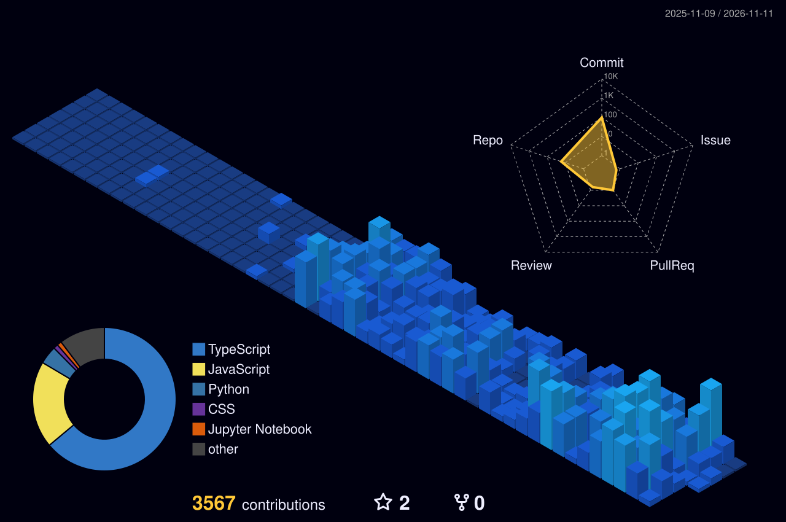

&nbsp; **South Korea**

  

 

## About

AI·소프트웨어·게임 현장 10년+  
LLM을 제품에 붙여 끝까지 배포  
지금은 코딩 교육 도구를 만듭니다

 

## Now building

### 코딩 교육 플랫폼

학생들이 매일 쓰는 코딩 학습 플랫폼

- 브라우저 IDE · 자동 채점
- 실시간 튜터링 · 학습 분석
- 학부모 문자 AI · 운영 도구
- Next.js + Convex · 커밋 2,300개

 

## Projects

공개 저장소 48개 중 일부

**교육 · 시뮬레이션**

- **[VSR](https://github.com/Kevin-innovation/virtual_science_room-VSR)** · [데모](https://virtual-science-room-vsr.vercel.app)  
  1인칭 3D 가상 과학실
- **[esp32-div2](https://github.com/Kevin-innovation/esp32-div2)** · [데모](https://esp32-div2.vercel.app)  
  ESP32-DIV 입문 실험
- **[spin-sphere](https://github.com/Kevin-innovation/spin-sphere)**  
  문자로 그린 회전 3D 구
- **[py-algo](https://github.com/Kevin-innovation/py-algo)** · [데모](https://py-algo.vercel.app)  
  파이썬 알고리즘 시각화
- **[jupyter-lecture](https://github.com/Kevin-innovation/jupyter-lecture)**  
  Colab 파이썬 강의
- **[magnetic_simulator](https://github.com/Kevin-innovation/magnetic_simulator)**  
  3D 자석·철가루 시뮬

**게임**

- **[metro-dash](https://github.com/Kevin-innovation/metro-dash)** · [데모](https://metro-dash-gold.vercel.app)  
  3레인 엔들리스 러너
- **[inthe-world](https://github.com/Kevin-innovation/inthe-world)** · [데모](https://inthe-world.vercel.app)  
  방치형 국가 시뮬
- **[ticket2ride](https://github.com/Kevin-innovation/ticket2ride)** · [데모](https://ticket2ride.vercel.app)  
  철도 보드게임 웹판
- **[sword-rpg](https://github.com/Kevin-innovation/sword-rpg)** · [데모](https://sword-rpg.vercel.app)  
  검 강화·랭킹 게임
- **[EVADE](https://github.com/Kevin-innovation/EVADE)**  
  웨이브 생존 로그라이크

**도구 · 웹**

- **[chess_review](https://github.com/Kevin-innovation/chess_review)** · [데모](https://chess-review-pink.vercel.app)  
  Stockfish 기보 분석
- **[no-smartphone](https://github.com/Kevin-innovation/no-smartphone)**  
  스크린타임 디톡스 앱
- **[shader-temp](https://github.com/Kevin-innovation/shader-temp)** · [데모](https://shader-temp.vercel.app)  
  웹 셰이더 템플릿
- **[TSL8 Tesla Guide](https://github.com/Kevin-innovation/TSL8-Tesla-chip-guide-by-Korean)** · [데모](https://tsl-8-tesla-chip-guide-by-korean.vercel.app)  
  한국어 Tesla 칩 가이드

<a href="https://github.com/Kevin-innovation?tab=repositories">전체 저장소 보기 →</a>

## Stack

  <picture>
    <source media="(prefers-color-scheme: light)" srcset="https://skillicons.dev/icons?i=py%2Cts%2Cjs%2Cjava%2Cc%2Ccpp%2Ccs%2Chtml%2Ccss%2Creact%2Cnextjs%2Cnodejs%2Ctailwind%2Cvite%2Cthreejs&theme=light" />
    
  </picture>
   
  <picture>
    <source media="(prefers-color-scheme: light)" srcset="https://skillicons.dev/icons?i=express%2Csupabase%2Cmongodb%2Cmysql%2Credis%2Cvercel%2Caws%2Cdocker%2Ckubernetes%2Cgithubactions%2Cgit%2Cfigma%2Cunity%2Cunreal%2Cpytorch&theme=light" />
    
  </picture>

  
  
  
  
  

## Activity

<picture>
  <source media="(prefers-color-scheme: light)" srcset="./profile-3d-contrib/profile-green.svg" />
  
</picture>

## Contact

AI 연동 · 웹 · 게임 · 교육 도구  
의뢰와 협업 모두 환영합니다

